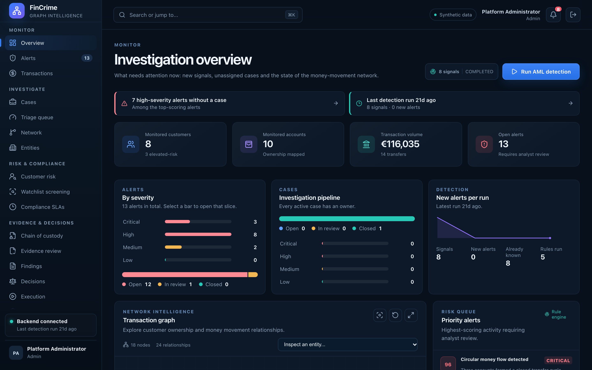
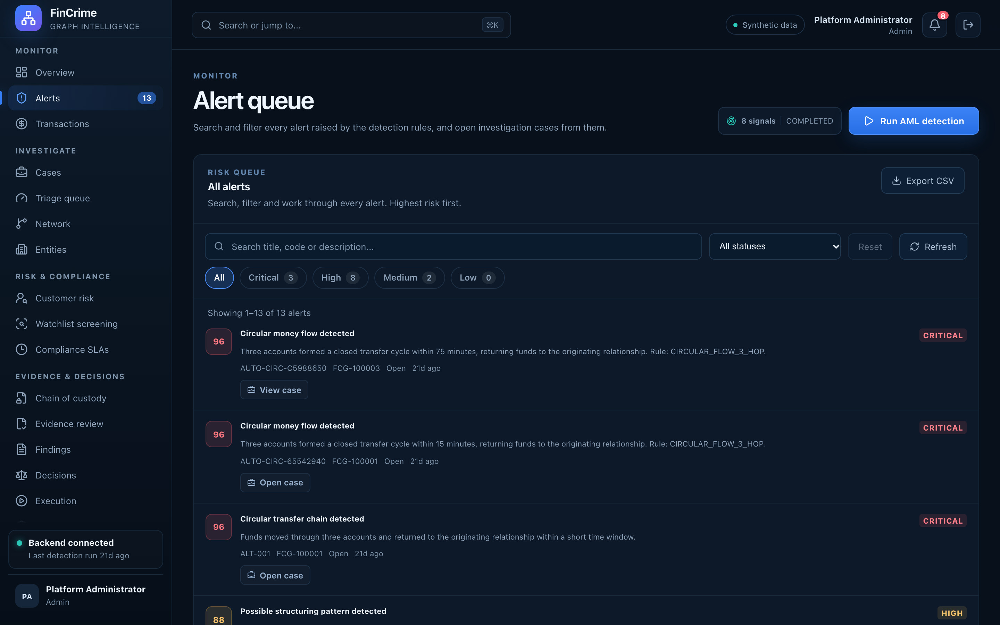
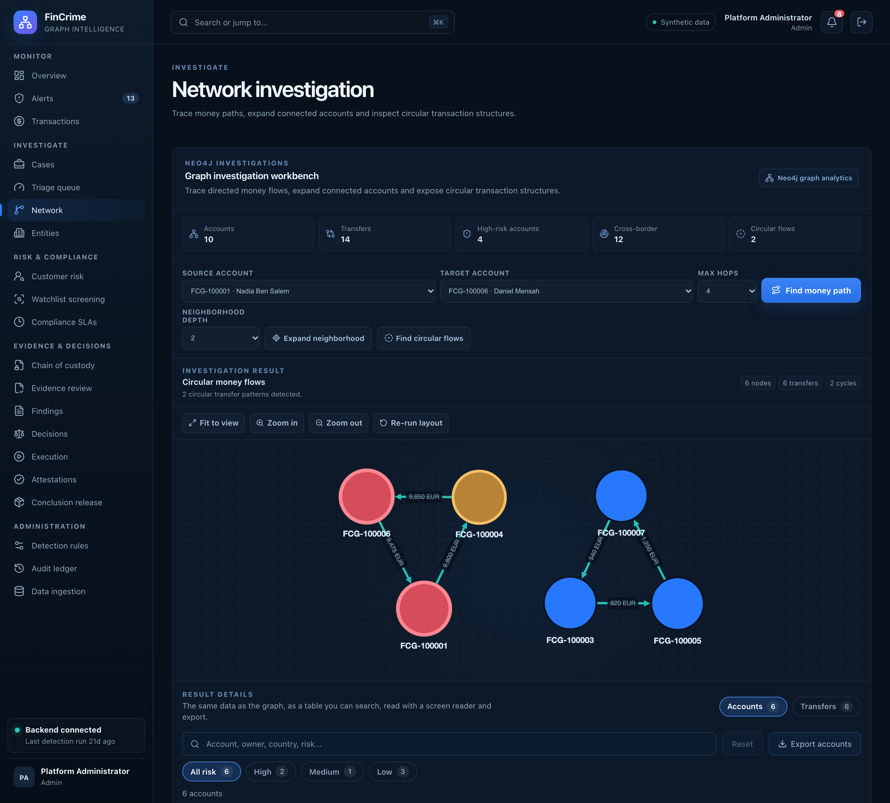
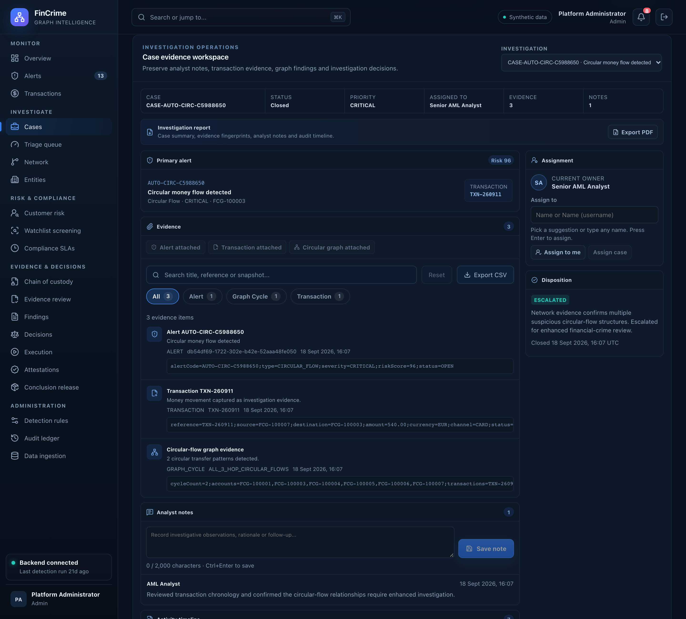
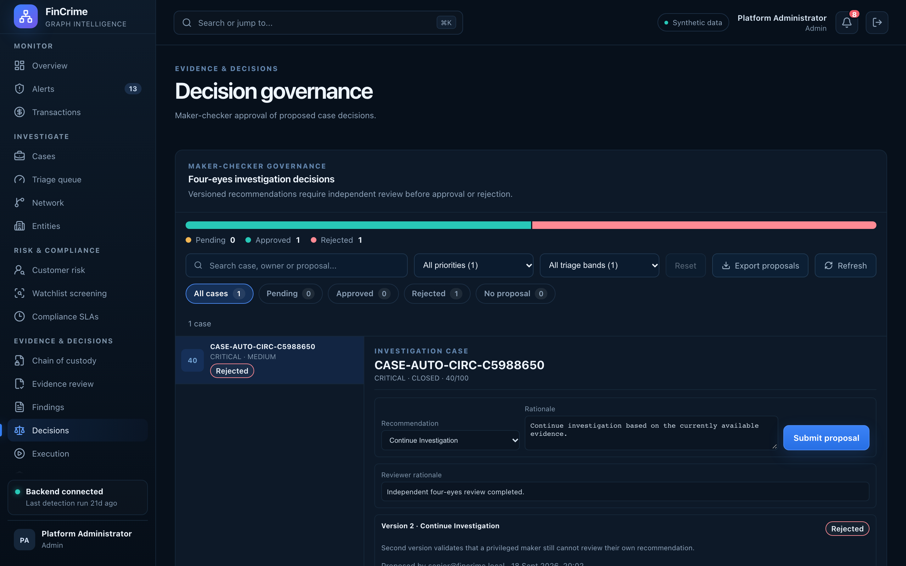
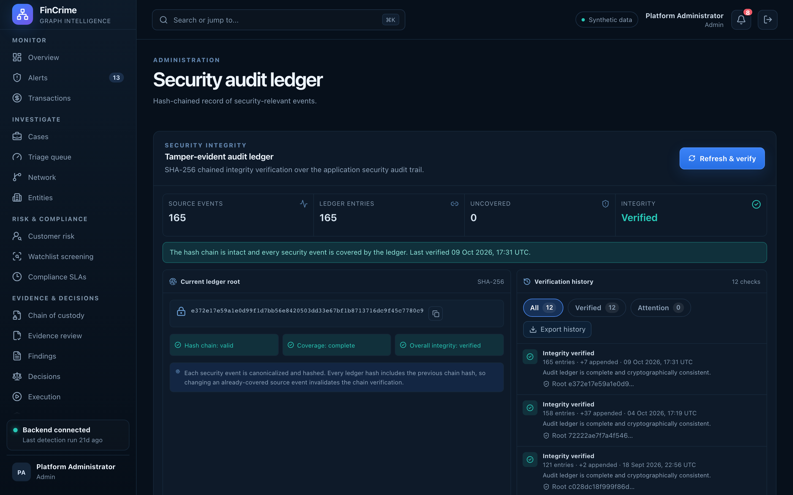
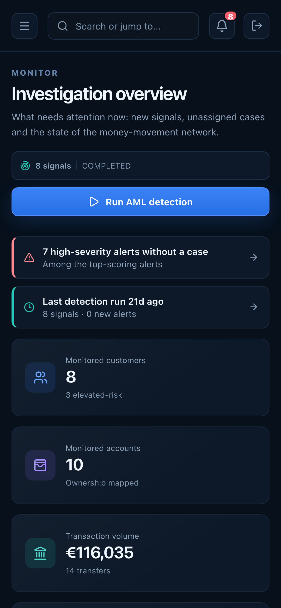

# FinCrime Graph: case study

*Add your role and timeline in scripts/portfolio/profile.json*



*What needs attention now, on one screen.*

## Overview

Financial-crime teams drown in alerts that live in separate tools, and the patterns that matter (money looping back to its origin, funds split below reporting limits) are hard to see in rows of transactions. FinCrime Graph puts the whole workflow in one place. Detection rules raise alerts, a graph database shows how accounts are connected, and customer risk scoring and watchlist screening add context. An analyst opens a case, attaches evidence, and the case then passes through independent review, a maker-checker decision, controlled execution and a sealed outcome, with every step written to a hash-chained audit ledger.

## The problem

- Alerts, customer data and case notes sit in different tools, so analysts spend their time copying context instead of investigating.
- Laundering patterns such as circular flows are structural: they are easy to see on a graph and almost invisible in a transaction table.
- Regulators and auditors ask who decided what, on which evidence, and whether that evidence was changed afterwards. Spreadsheets and email cannot answer that reliably.

## The approach

- One workspace for the whole path: signal, alert, case, evidence, finding, decision, outcome.
- Rule-based detection for five typologies, backed by a graph database for path and cycle queries.
- Governance built into the workflow: four-eyes review, role-gated execution, integrity hashes and a hash-chained audit ledger.



*Every alert, searchable and filterable on the server.*



*A circular flow found on the money-movement graph.*



*Notes, evidence, owner and timeline for one case.*

## How it works

```text
  Browser (Next.js 16 + React 19, TypeScript, Cytoscape)
        |  JSON over HTTPS, JWT bearer token
        v
  Spring Boot 4 REST API (Java 21)
   |- security: JWT (HS256), roles, sign-in lockout, audit
   |- services: detection, cases, risk, watchlist, governance
   |
   |--> PostgreSQL 17  (system of record, Flyway migrations)
   '--> Neo4j         (money-flow graph: accounts and TRANSFERRED_TO links)
```

- PostgreSQL is the system of record for customers, accounts, transactions, alerts, cases, evidence and the audit trail. Schema changes are versioned Flyway migrations.
- Neo4j holds a projection of accounts and transfers (TRANSFERRED_TO relationships) so path, neighbourhood and cycle questions are one Cypher query instead of many joins. It is rebuilt from PostgreSQL in a single transaction, so readers never see a half-built graph.
- The API is stateless. A signed JWT (8 hours by default) carries the user and role, and method-level security decides who may do what.
- The web app is a single-page workspace. Navigation lives in the URL hash, and each module sits in its own error boundary.



*Maker-checker approval of case decisions.*

## Decisions that shaped it

**Two databases, one source of truth.** Relational data stays in PostgreSQL and the graph is a rebuildable projection in Neo4j. Graph questions are fast and natural, and a graph problem can never corrupt the records of the case.

**Governance as code, not as a policy document.** Maker-checker review, role gates, integrity hashes and a hash-chained audit ledger are enforced by the services themselves, so an analyst cannot skip a step by accident.

**Identity comes from the token.** Case notes and audit entries are attributed to the signed-in user taken from the JWT. Request parameters that claim to say who acted are ignored, so nobody can write under another name.

**Safe by default.** A guard refuses to start the production profile while the demo secret or demo passwords are still in use. Sign-in is rate limited per user name, audit text is clipped to its column width, and free text is sent in the request body instead of the URL so it stays out of access logs.

**Degrade, do not fail.** Overview data is loaded with Promise.allSettled, every module has its own error boundary and a 401 returns the user to sign-in with a clear message. One broken dependency costs one panel, not the whole screen.

## Challenges

- Keeping a graph and a relational database consistent: solved by treating the graph as a projection that is rebuilt in one transaction, in batches.
- Making a very wide product (twenty modules) feel like one product: grouped navigation, one command palette, shared list tools and a shared design layer.
- Proving that evidence was not altered: integrity hashes at each stage, and an audit ledger whose entries are chained to the one before.
- Testing a UI without a backend at hand: browser tests against a mock API, plus unit tests for the rules that carry the risk (lockout, audit range, assignment).

## Result

The platform runs end to end on synthetic data: 20 modules, 91 REST endpoints, 18 database migrations and 97 automated unit tests.

Built with Spring Boot 4.1.1, Java 21, PostgreSQL 17-alpine, Neo4j (graph) 2026.08.1-community, Next.js 16.3.3, React 19.2, TypeScript 5.9, Cytoscape.js (network graph) 3.34.3.



*A hash-chained record of security-relevant events.*

## What I learned

- Modelling workflow states explicitly makes governance rules easy to test.
- Server-side paging, filtering and counts matter early; in-memory filtering only works while the data is small.
- Accessibility work (focus management, combobox semantics, reduced motion) is cheaper when it is part of the first build of a component.

## What is next

- Real user store and an httpOnly cookie session.
- Paged analytics lists and a bounded graph query for large data.
- Integration tests against real PostgreSQL and Neo4j containers, and CI.
- Local-time display and user preferences.



*The same product on a phone.*
