# Screenshots

29 pictures. Each has a caption, a longer description and talking points; the same text is in `screenshots.json` and next to each image in `screenshots/`.

## 01. Sign-in

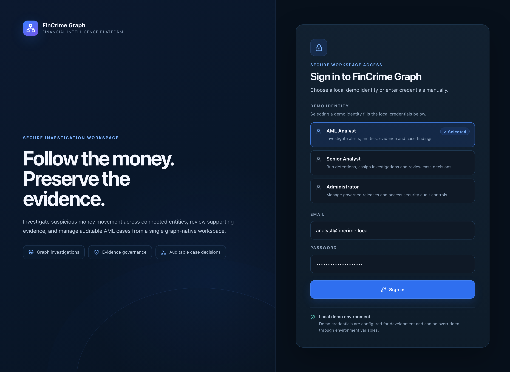

**Sign-in with role-based demo identities.**

The entry point. Three demo identities (analyst, senior analyst and administrator) show how the same application changes with the role. Sessions use signed JWTs, and five failed attempts for one user name lock that name for five minutes.

- Role-based access from the very first screen.
- Sign-in lockout with a Retry-After wait shown to the user.
- A guard refuses to start the production profile with demo secrets.

## 02. Investigation overview

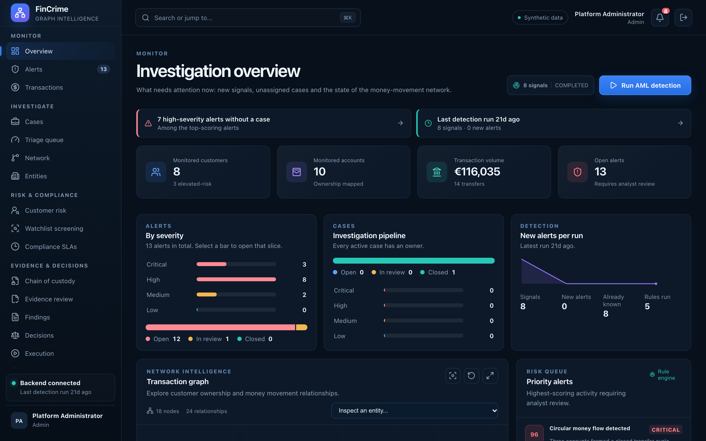

**What needs attention now, on one screen.**

The analyst's home page: new signals, unassigned cases and the state of the money-movement network. Each panel loads on its own, so a failing data source shows an inline message instead of blanking the page.

- Panels load independently with Promise.allSettled.
- The last good data is kept if a refresh fails.
- The notification bell lists severe open alerts and unassigned cases.

## 03. Alert queue

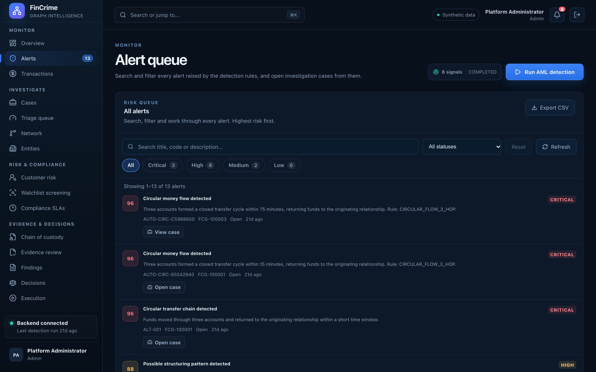

**Every alert, searchable and filterable on the server.**

All alerts raised by the detection rules, with search, severity and status filters that show live counts, paging and a link to each alert. An analyst can open an investigation case straight from an alert.

- Five detection typologies: circular flow, structuring, large cross-border, high-risk counterparty, velocity anomaly.
- Search and filters run in the database; user text is always a bound parameter.
- Saved filter views and CSV export.

## 04. Transactions

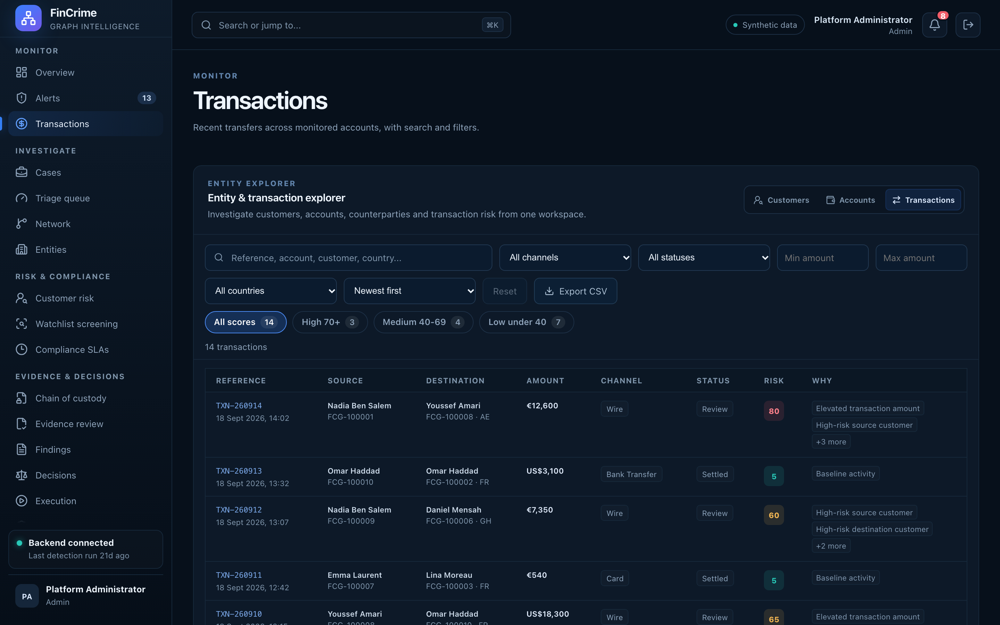

**Recent transfers across all monitored accounts.**

A searchable, filterable list of the transfers that the detection rules and the graph work on.

- Deep links to one transaction by reference.
- Reachable from the command palette.

## 05. Investigation cases

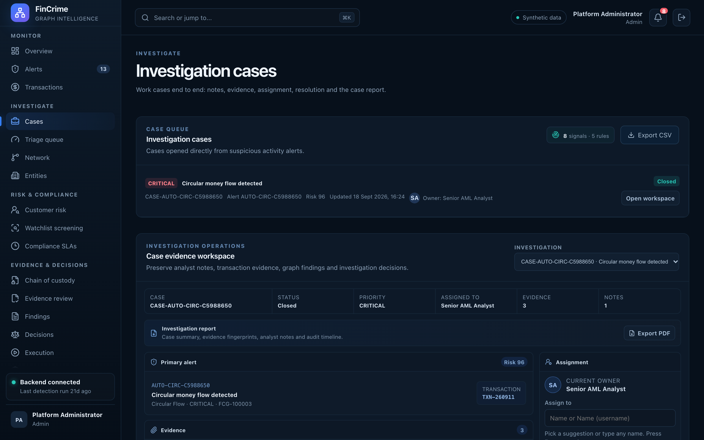

**The case queue, ordered by what matters.**

Every investigation case with its status, priority, owner and risk score. Cases are opened from alerts and worked end to end in the case workspace.

- Case lifecycle: open, in review, closed.
- Closing a case needs a disposition (no action, false positive, escalated or SAR recommended) and a written summary.

## 06. Case workspace

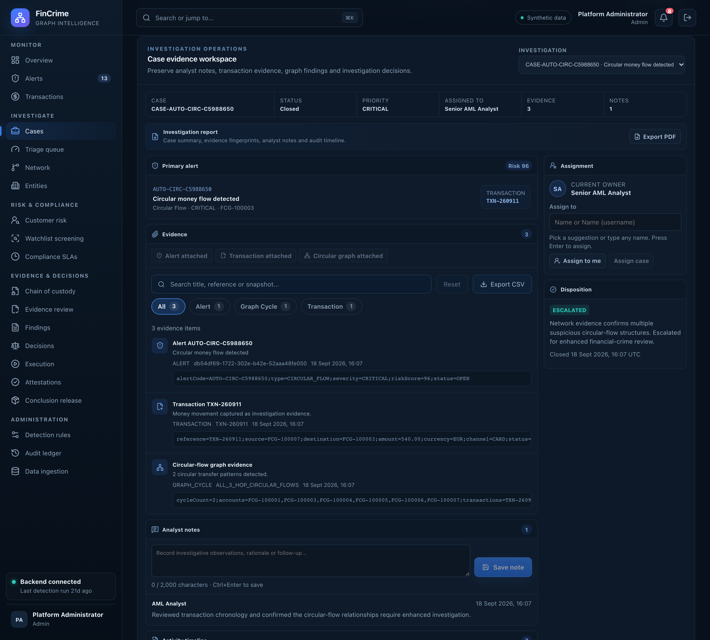

**Notes, evidence, owner and timeline for one case.**

Where the investigation happens. The analyst attaches alerts, transactions and circular-flow graph evidence, assigns or unassigns the case, and resolves it with a disposition. The investigation report, with evidence fingerprints, notes and the audit timeline, exports as a PDF.

- Notes and audit entries are attributed from the JWT, not from the request.
- Unassigning is idempotent and recorded on the timeline.
- Free text travels in the request body, not the URL.

## 07. Case notes and timeline

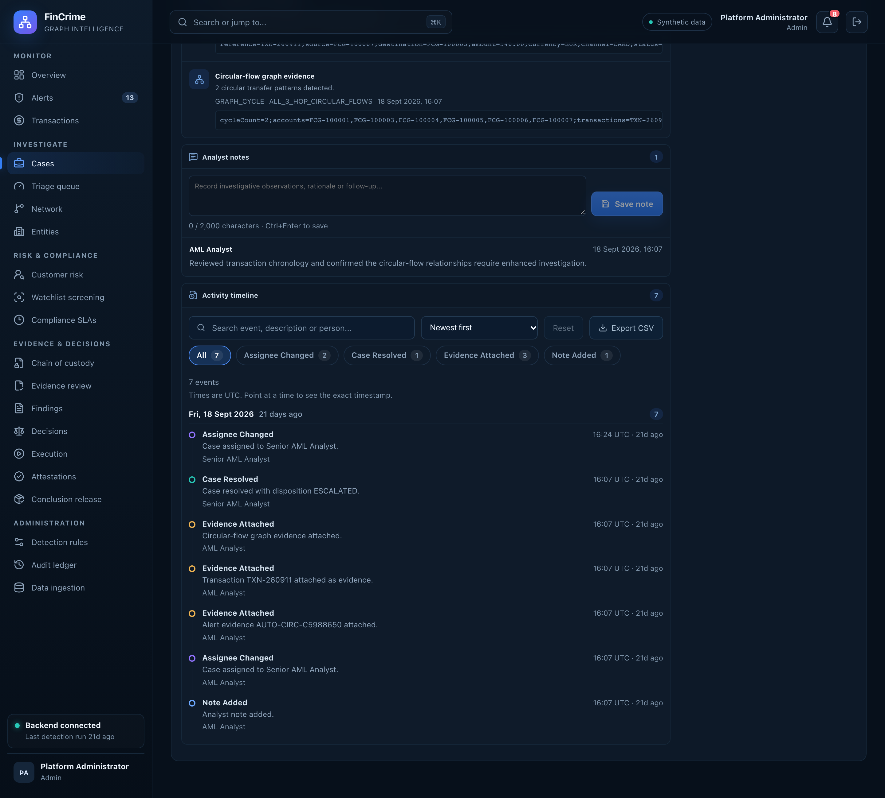

**Analyst notes and a day-by-day activity timeline.**

Notes are saved with Ctrl or Cmd + Enter and signed with the analyst's identity. Every action on the case lands on an activity timeline that is grouped by day, shown in UTC, and can be searched, filtered by event type and exported to CSV.

- Every change to a case is a timeline event.
- Search, filter chips and CSV export on the timeline.
- Times are shown in UTC with the exact timestamp on hover.

## 08. Investigation triage

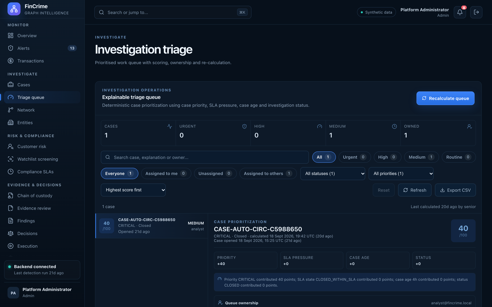

**A prioritised work queue with scores and owners.**

Open cases scored and ordered so the most urgent work comes first, with ownership and a recalculate action that records each run.

- Each scoring run is stored, so the order can be explained later.
- Ownership can be assigned from the queue.

## 09. Network investigation

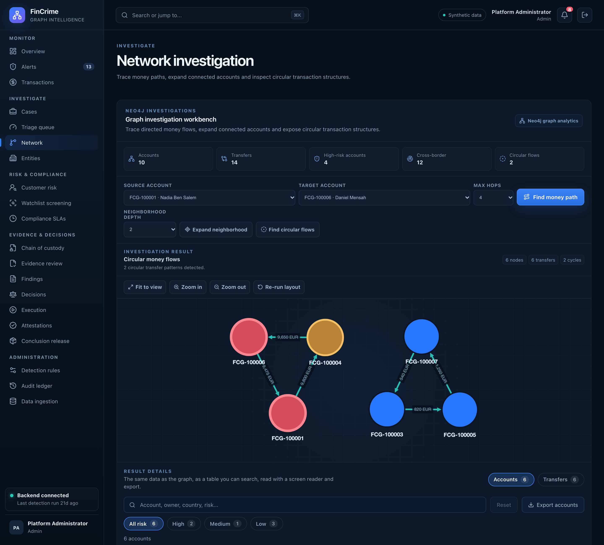

**Money paths and circular flows on a Neo4j graph.**

The graph investigation workbench on Neo4j, here after pressing Find circular flows. Money that leaves an account and returns to it through intermediaries shows up as a loop. Analysts can also trace a path between two accounts and expand an account's neighbourhood.

- TRANSFERRED_TO relationships rebuilt from PostgreSQL in one transaction.
- Circular flows can be attached to a case as evidence.
- Rendered with Cytoscape.js.

## 10. Money path between two accounts

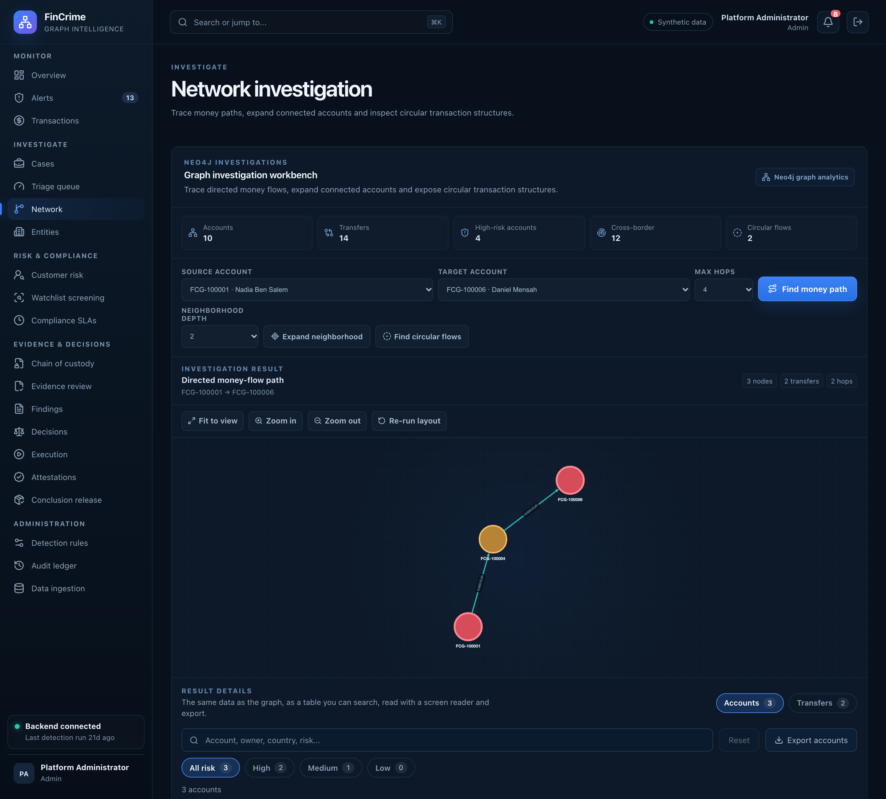

**How money got from one account to another.**

Pick a source and a target account and a hop limit, and the workbench traces the directed path the money took through intermediary accounts.

- A directed path query in Cypher, bounded by a maximum number of hops.
- Each hop is a real transfer that can be opened and attached to a case.

## 11. Entities

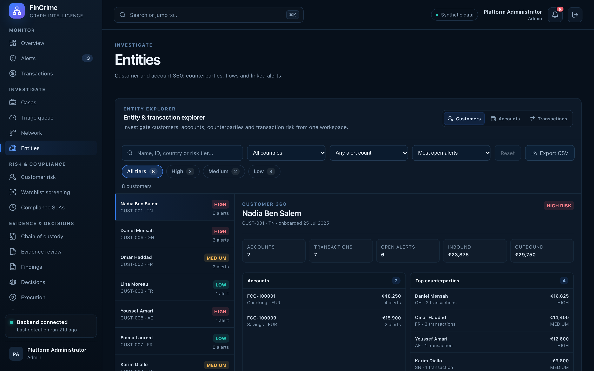

**Customer and account 360.**

Customers and accounts with their counterparties, flows and linked alerts, so an analyst sees who they are dealing with without leaving the platform.

- Search that tolerates a failing API instead of throwing.
- Pre-filled from the command palette.

## 12. Customer risk assessment

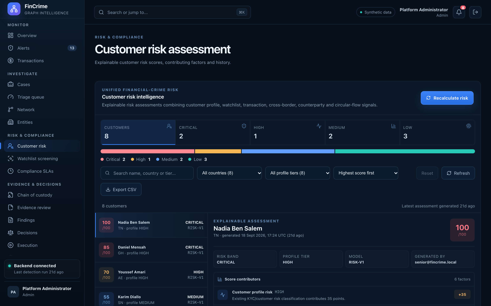

**Explainable customer risk scores.**

Each customer's risk score is built from six factors: customer profile, watchlist matches, transaction volume, cross-border activity, high-risk counterparties and circular flow. The factors are shown, so the number can be defended.

- Explainability over a black-box score.
- Assessments are kept as history.

## 13. Watchlist screening

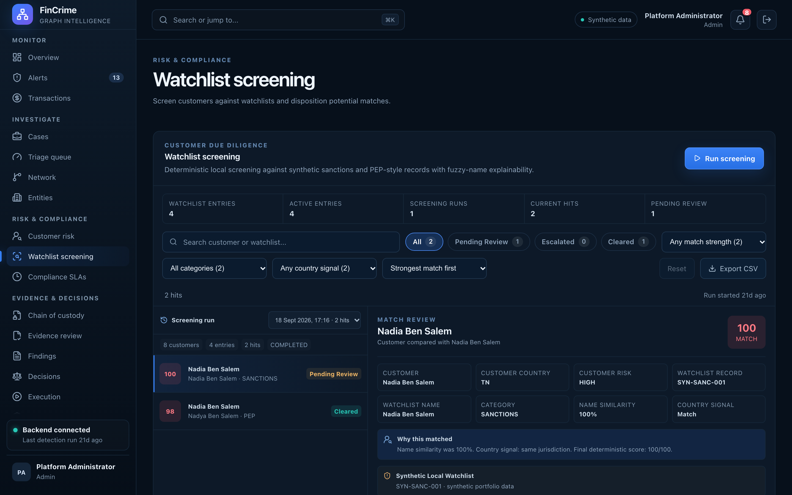

**Fuzzy name screening against watchlists.**

Customers are screened against watchlist entries with Levenshtein similarity, aliases included, and a match threshold of 80. Potential matches are cleared or escalated by an analyst with a note.

- Aliases are matched as well as primary names.
- A review decision is recorded with a note.

## 14. Compliance operations

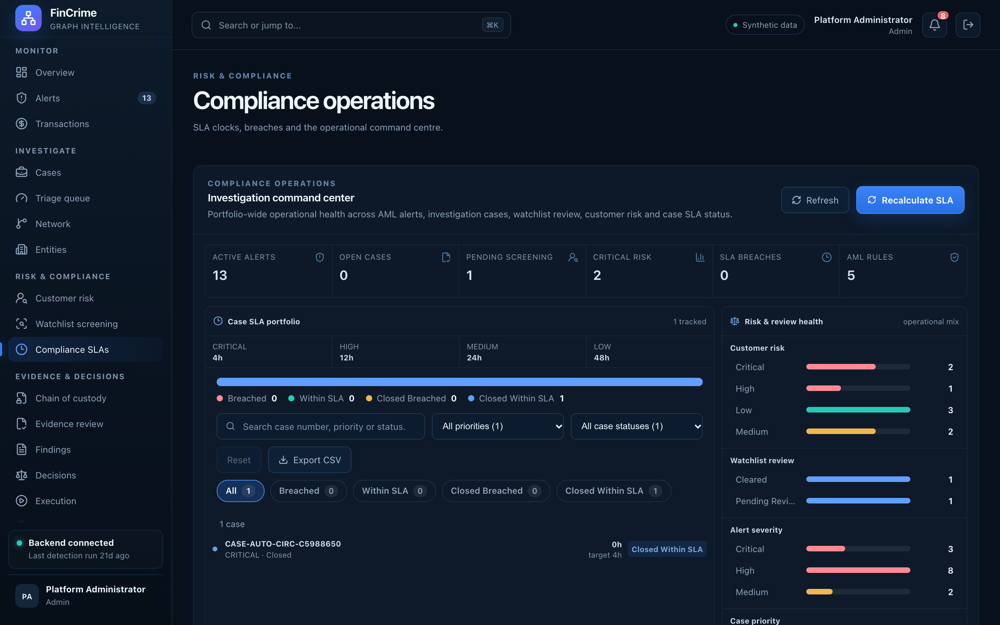

**SLA clocks and the compliance command centre.**

Policy-driven SLA clocks for open cases, with breaches called out and a feed of recent activity, so a compliance lead sees where the process is slipping.

- SLA status is recalculated on demand and recorded.
- Senior analyst or administrator role required to recalculate.

## 15. Evidence chain of custody

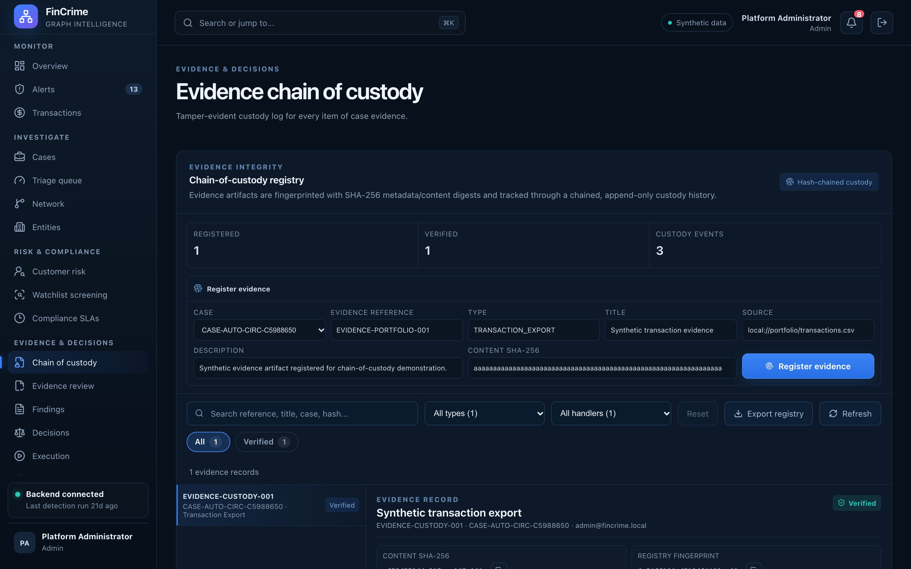

**A tamper-evident log for every item of evidence.**

Each piece of case evidence has a custody log. Integrity hashes (SHA-256) let anyone verify that the evidence is the same as when it was attached.

- Hash verification instead of trust.
- CSV export of custody records.

## 16. Evidence review

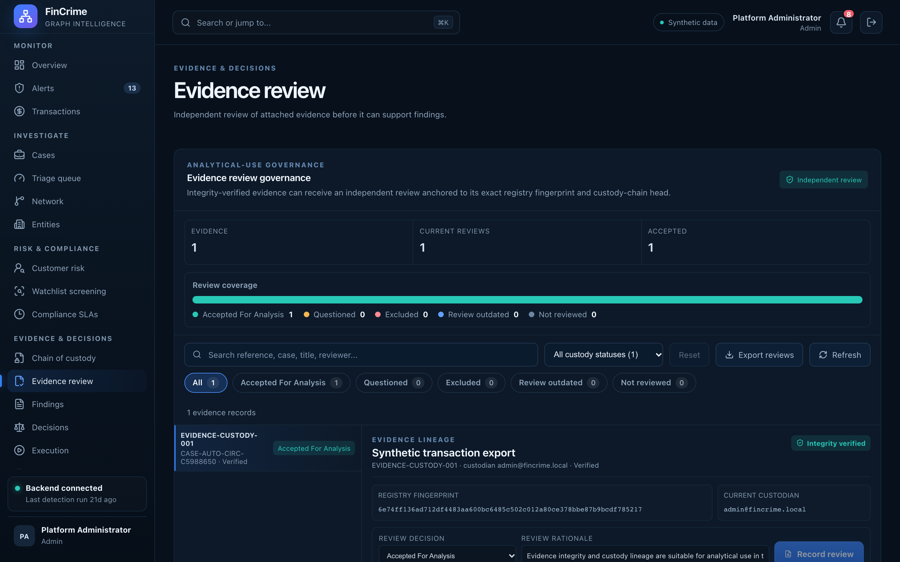

**Independent review before evidence counts.**

Attached evidence is reviewed before it can support a finding, and the reviewer must be someone other than the evidence's current custodian.

- Four-eyes rule enforced by the service, not by convention.
- Review decisions are part of the audit trail.

## 17. Investigation findings

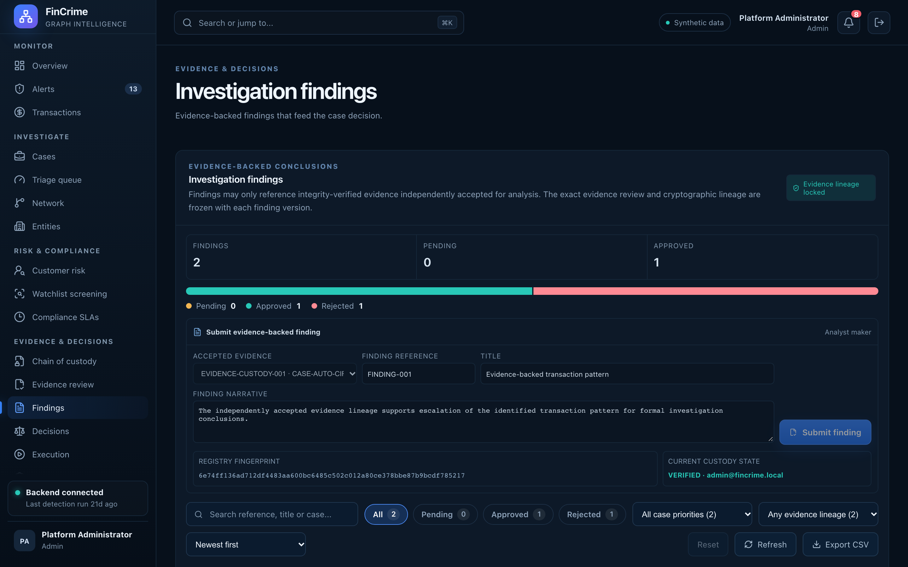

**Findings that point back to their evidence.**

Conclusions are recorded as findings, each tied to evidence that passed integrity verification and was accepted in review, so a decision can always be traced to what supports it. A finding is reviewed by someone other than its submitter.

- A finding can only rest on integrity-verified, accepted evidence.
- Feeds the decision step.

## 18. Decision governance

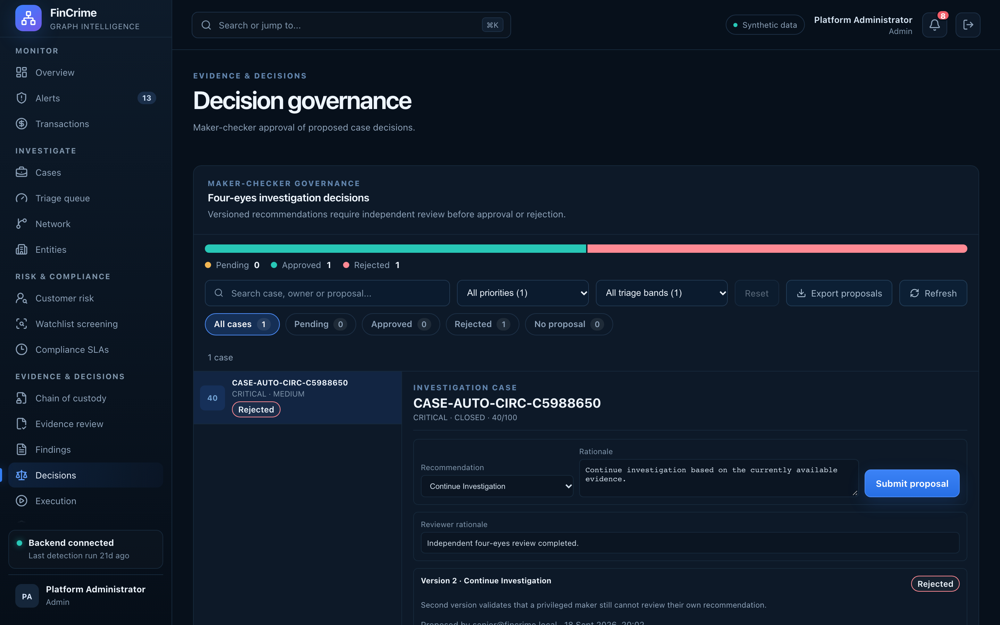

**Maker-checker approval of case decisions.**

Decisions are proposed by one person and reviewed by another. The service rejects a review by the proposer.

- Separation of duties enforced in a policy class with unit tests.
- Every transition is recorded.

## 19. Controlled decision execution

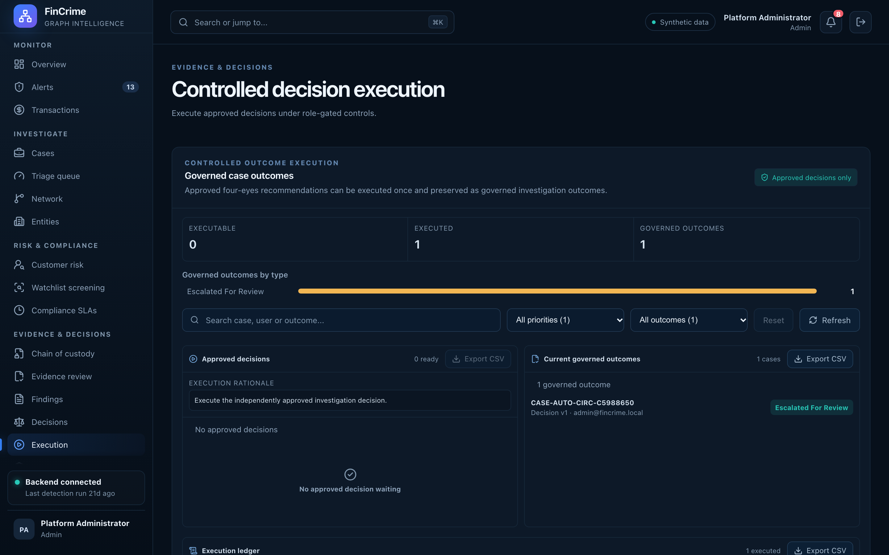

**Approved decisions executed under role-gated controls.**

Only approved decisions can be executed, only by a senior analyst or administrator, and each execution and outcome is written to a ledger.

- Role-gated with Spring method-level security.
- Outcomes carry a provenance hash.

## 20. Outcome attestations

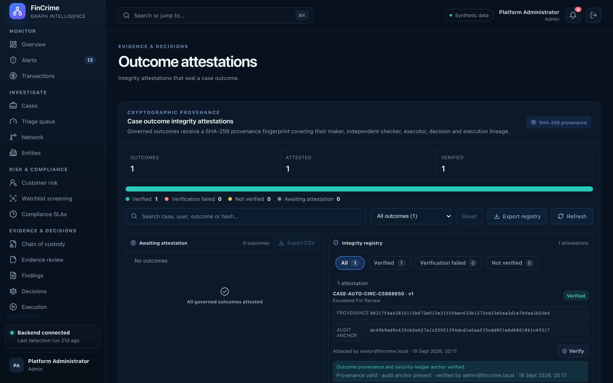

**Integrity attestations that seal a case outcome.**

The outcome of a case is sealed with an attestation. Later verification shows whether the recorded outcome still matches what was attested.

- Seal and verify, with verification history.
- Built on SHA-256 hashing.

## 21. Conclusion release

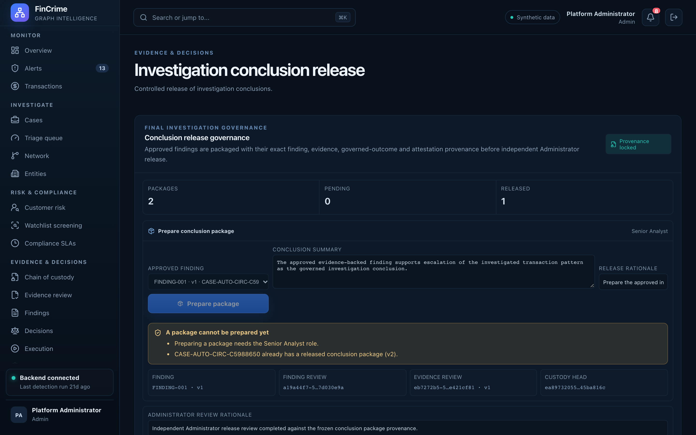

**Controlled release of investigation conclusions.**

A conclusion leaves the investigation only through a controlled release. The reviewer must differ from whoever prepared the package, and a release fingerprint records exactly what was released.

- Release fingerprint (SHA-256) of the released content.
- Fourth four-eyes checkpoint, after evidence, findings and decisions.

## 22. Detection rule governance

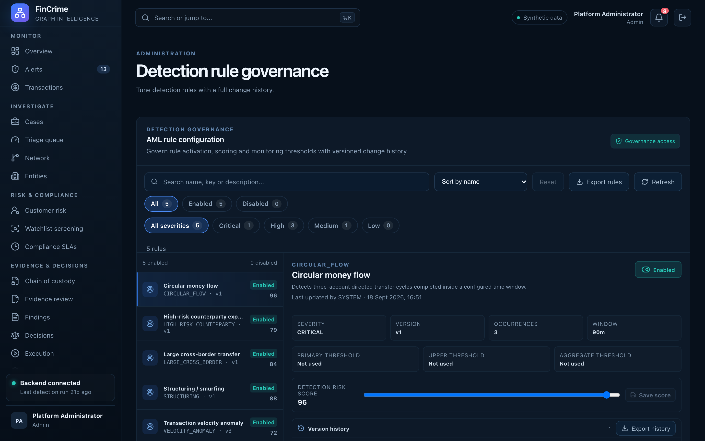

**Tune detection rules with a full change history.**

Detection thresholds are not hard-coded. A senior analyst or administrator can change a rule with a written change summary, and every change is kept in the history.

- Change summaries are sent in the request body, not the URL.
- Role-gated: an analyst cannot retune a rule.

## 23. Security audit ledger

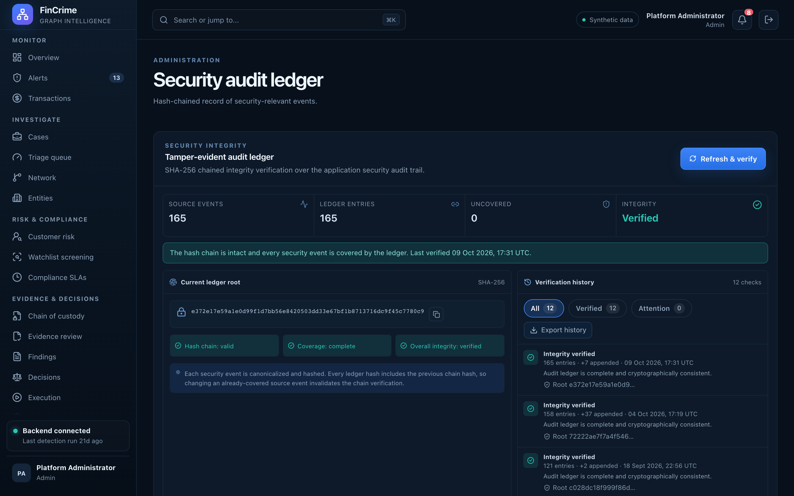

**A hash-chained record of security-relevant events.**

Administrators can search security events by date range and check the ledger's hash chain. Each entry is chained to the one before, so removing or editing history is detectable.

- Server-side date-range search with a total count.
- Refresh extends the chain; verification reports whether it is valid.

## 24. Data ingestion

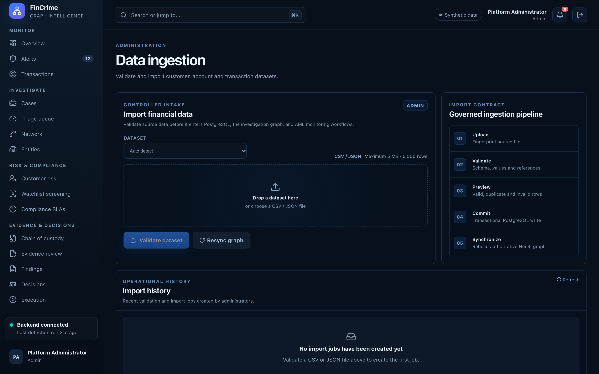

**Validate and import customer, account and transaction data.**

Upload CSV or JSON datasets, preview and validate them against a schema, import them and re-synchronise the graph. Each import is hashed and logged.

- Preview before import.
- Import jobs keep a log.
- The graph is re-synchronised from PostgreSQL afterwards.

## 25. Command palette

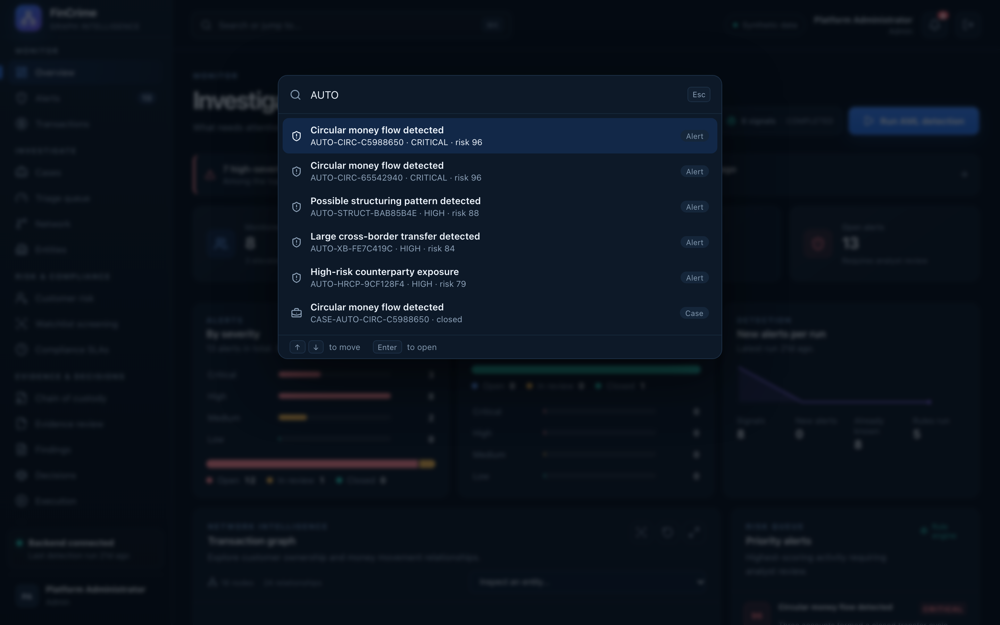

**Jump anywhere, or search alerts, cases and transactions.**

Press Ctrl or Cmd + K (or the slash key) from any screen to jump to a module or search alerts, cases and transactions by code, reference, account or name.

- Proper combobox and listbox semantics, fully keyboard driven.
- Every result is a deep link.

## 26. Sign-in on a phone

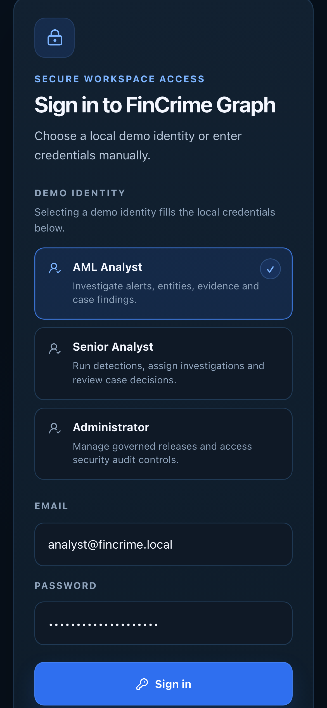

**The sign-in screen on a phone.**

The same sign-in, laid out for a narrow screen.

- Same form, same demo identities, laid out for a narrow screen.

## 27. Overview on a phone

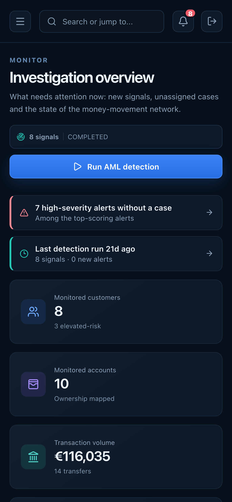

**The overview on a phone.**

Panels stack into a single column and the sidebar becomes an off-canvas menu.

- Breakpoints at 1180, 1024, 850, 780 and 480 px.
- Comfortable touch targets.

## 28. Navigation menu on a phone

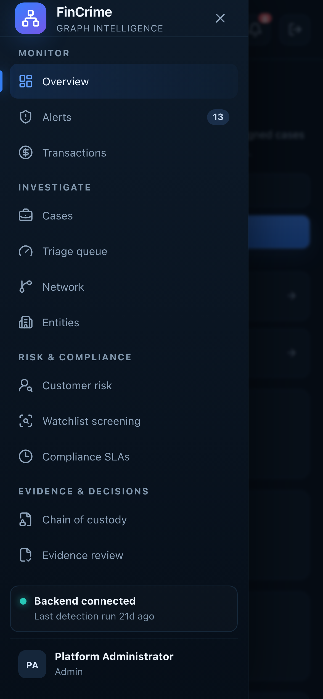

**The grouped navigation as an off-canvas menu.**

On screens up to 850 px the sidebar turns into a drawer with the same five groups, instead of an icon rail without labels.

- Focus is managed when the drawer opens and closes.

## 29. Alerts on a phone

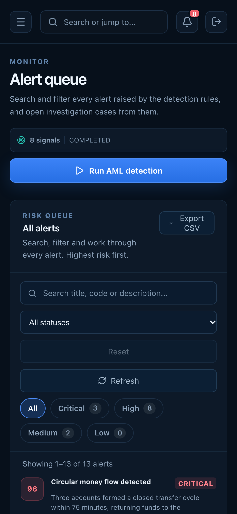

**The alert queue on a phone.**

Filters and the alert list reflow for one-handed use.

- Same server-side search and filters as on the desktop.
