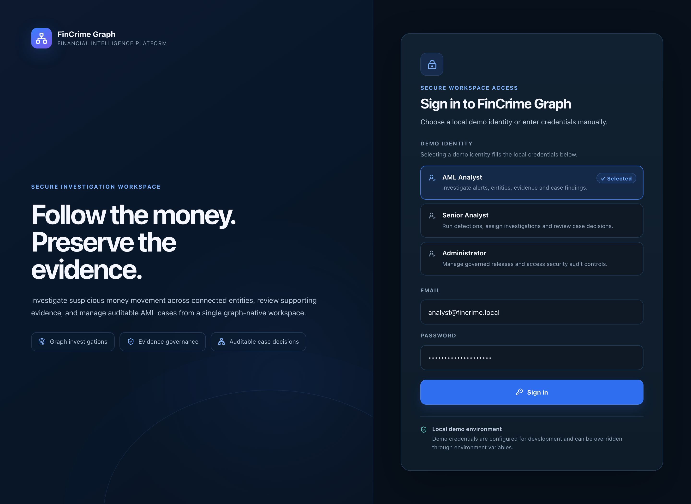

# Sign-in

**Caption:** Sign-in with role-based demo identities.

**Alt text:** FinCrime Graph sign-in screen with a choice of local demo identities

**Where in the app:** Sign-in screen

**Image:** 01-login.png, 2,880 x 2,100 px, 1196 KB, captured 2026-10-09

## Description

The entry point. Three demo identities (analyst, senior analyst and administrator) show how the same application changes with the role. Sessions use signed JWTs, and five failed attempts for one user name lock that name for five minutes.

## Talking points

- Role-based access from the very first screen.
- Sign-in lockout with a Retry-After wait shown to the user.
- A guard refuses to start the production profile with demo secrets.
