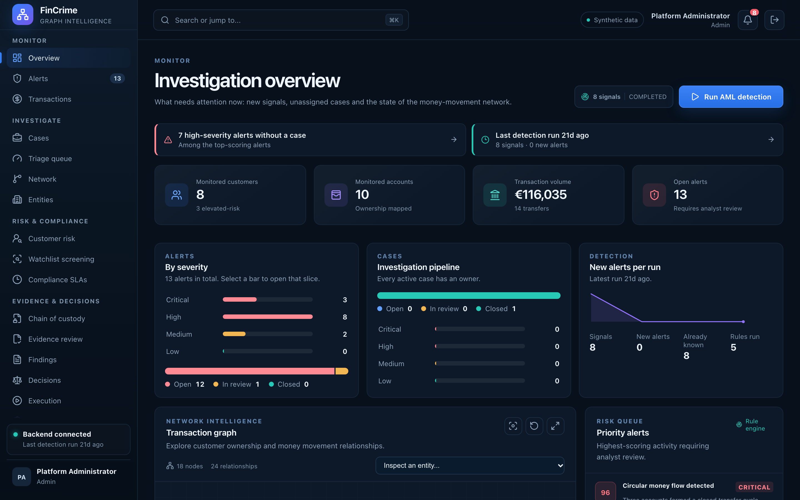

# Investigation overview

**Caption:** What needs attention now, on one screen.

**Alt text:** Overview dashboard with alert, case and transaction summaries

**Where in the app:** Sidebar: Overview (`#/overview`)

**Image:** 02-overview.png, 2,880 x 1,800 px, 563 KB, captured 2026-10-09

## Description

The analyst's home page: new signals, unassigned cases and the state of the money-movement network. Each panel loads on its own, so a failing data source shows an inline message instead of blanking the page.

## Talking points

- Panels load independently with Promise.allSettled.
- The last good data is kept if a refresh fails.
- The notification bell lists severe open alerts and unassigned cases.
