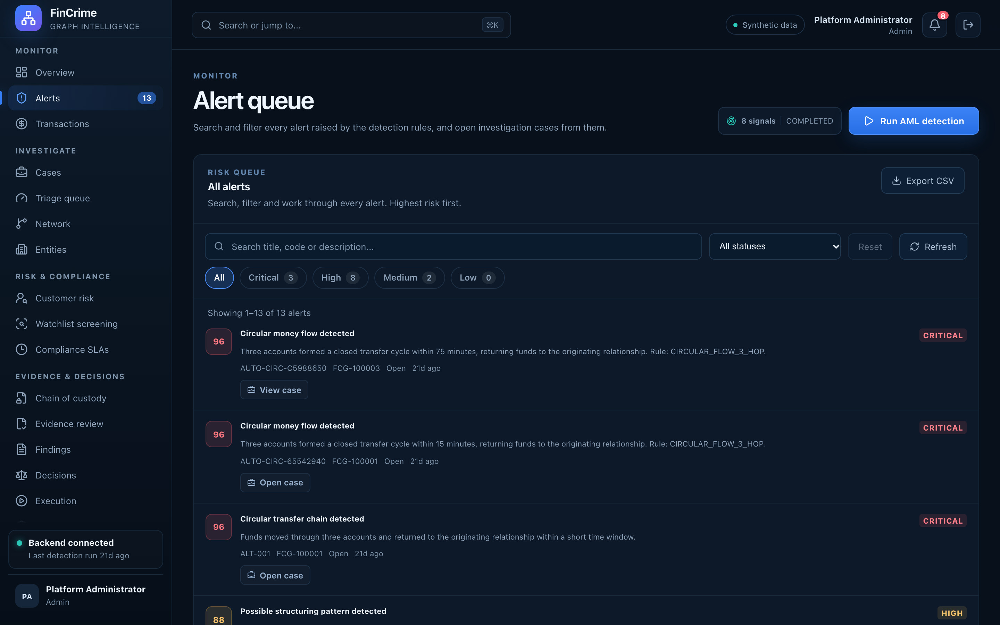

# Alert queue

**Caption:** Every alert, searchable and filterable on the server.

**Alt text:** Alert queue with severity and status filters and a list of alerts

**Where in the app:** Sidebar: Alerts (`#/alerts`)

**Image:** 03-alerts.png, 2,880 x 1,800 px, 478 KB, captured 2026-10-09

## Description

All alerts raised by the detection rules, with search, severity and status filters that show live counts, paging and a link to each alert. An analyst can open an investigation case straight from an alert.

## Talking points

- Five detection typologies: circular flow, structuring, large cross-border, high-risk counterparty, velocity anomaly.
- Search and filters run in the database; user text is always a bound parameter.
- Saved filter views and CSV export.
