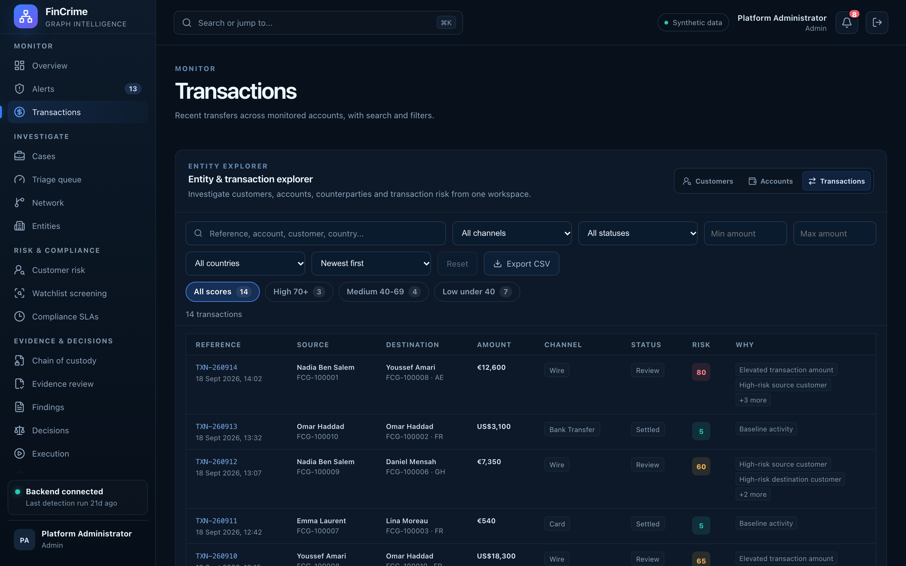

# Transactions

**Caption:** Recent transfers across all monitored accounts.

**Alt text:** Transactions list with search and filters

**Where in the app:** Sidebar: Transactions (`#/transactions`)

**Image:** 04-transactions.png, 2,880 x 1,800 px, 517 KB, captured 2026-10-09

## Description

A searchable, filterable list of the transfers that the detection rules and the graph work on.

## Talking points

- Deep links to one transaction by reference.
- Reachable from the command palette.
