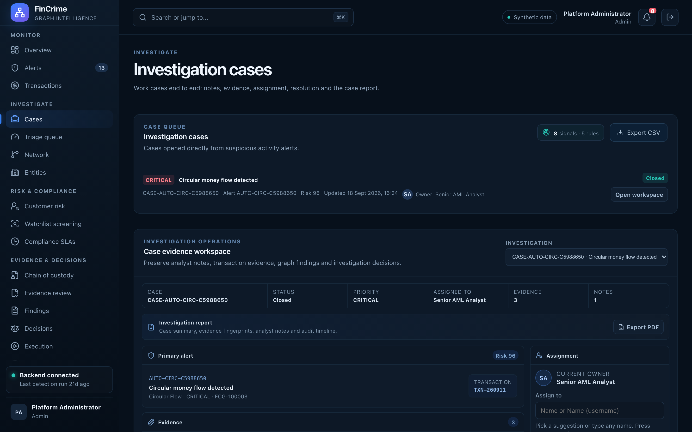

# Investigation cases

**Caption:** The case queue, ordered by what matters.

**Alt text:** Investigation case queue with status and priority

**Where in the app:** Sidebar: Cases (`#/cases`)

**Image:** 05-cases.png, 2,880 x 1,800 px, 530 KB, captured 2026-10-09

## Description

Every investigation case with its status, priority, owner and risk score. Cases are opened from alerts and worked end to end in the case workspace.

## Talking points

- Case lifecycle: open, in review, closed.
- Closing a case needs a disposition (no action, false positive, escalated or SAR recommended) and a written summary.
