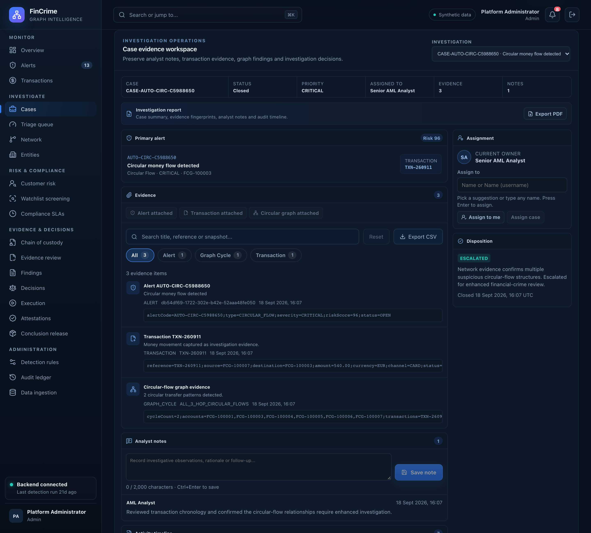

# Case workspace

**Caption:** Notes, evidence, owner and timeline for one case.

**Alt text:** Case workspace showing notes, evidence, assignment and timeline

**Where in the app:** Cases, then open a case (`#/cases/<id>`)

**Image:** 06-case-workspace.png, 2,880 x 2,600 px, 773 KB, captured 2026-10-09

## Description

Where the investigation happens. The analyst attaches alerts, transactions and circular-flow graph evidence, assigns or unassigns the case, and resolves it with a disposition. The investigation report, with evidence fingerprints, notes and the audit timeline, exports as a PDF.

## Talking points

- Notes and audit entries are attributed from the JWT, not from the request.
- Unassigning is idempotent and recorded on the timeline.
- Free text travels in the request body, not the URL.
