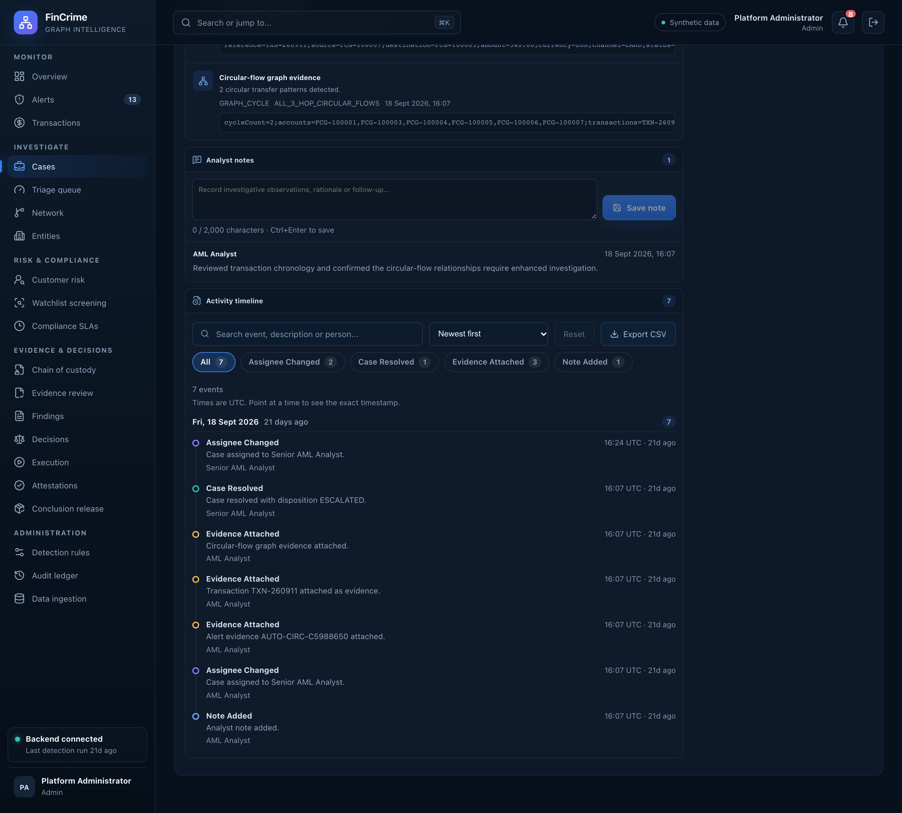

# Case notes and timeline

**Caption:** Analyst notes and a day-by-day activity timeline.

**Alt text:** Analyst notes and the activity timeline of a case

**Where in the app:** Cases, then open a case (`#/cases/<id>`)

**Image:** 07-case-timeline.png, 2,880 x 2,600 px, 636 KB, captured 2026-10-09

## Description

Notes are saved with Ctrl or Cmd + Enter and signed with the analyst's identity. Every action on the case lands on an activity timeline that is grouped by day, shown in UTC, and can be searched, filtered by event type and exported to CSV.

## Talking points

- Every change to a case is a timeline event.
- Search, filter chips and CSV export on the timeline.
- Times are shown in UTC with the exact timestamp on hover.
