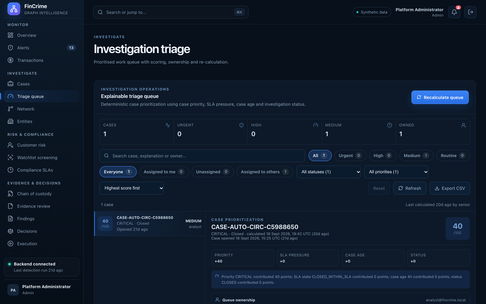

# Investigation triage

**Caption:** A prioritised work queue with scores and owners.

**Alt text:** Triage queue with scoring and ownership

**Where in the app:** Sidebar: Triage queue (`#/triage`)

**Image:** 08-triage.png, 2,880 x 1,800 px, 547 KB, captured 2026-10-09

## Description

Open cases scored and ordered so the most urgent work comes first, with ownership and a recalculate action that records each run.

## Talking points

- Each scoring run is stored, so the order can be explained later.
- Ownership can be assigned from the queue.
