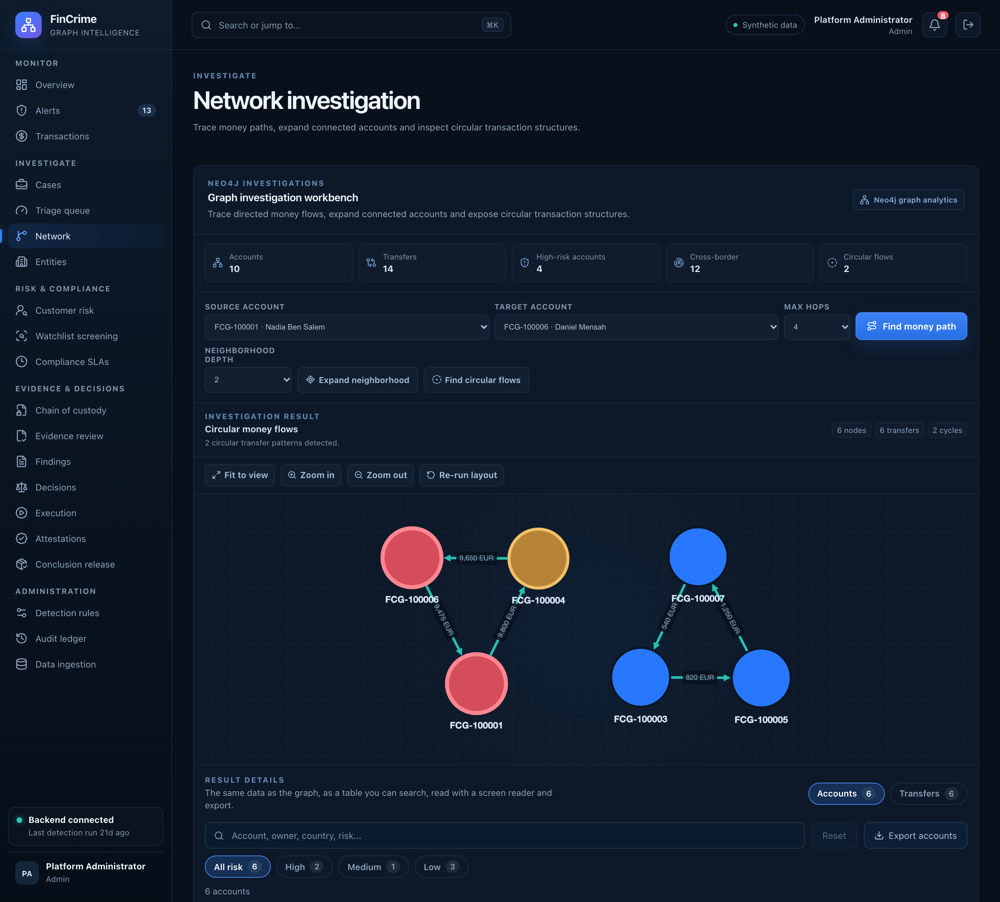

# Network investigation

**Caption:** Money paths and circular flows on a Neo4j graph.

**Alt text:** Interactive money-flow network graph

**Where in the app:** Sidebar: Network (`#/network`)

**Image:** 09-network.png, 2,880 x 2,600 px, 896 KB, captured 2026-10-09

## Description

The graph investigation workbench on Neo4j, here after pressing Find circular flows. Money that leaves an account and returns to it through intermediaries shows up as a loop. Analysts can also trace a path between two accounts and expand an account's neighbourhood.

## Talking points

- TRANSFERRED_TO relationships rebuilt from PostgreSQL in one transaction.
- Circular flows can be attached to a case as evidence.
- Rendered with Cytoscape.js.
