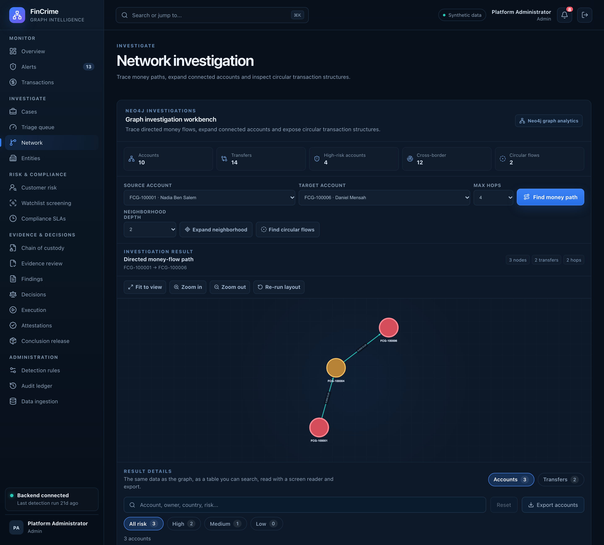

# Money path between two accounts

**Caption:** How money got from one account to another.

**Alt text:** Graph showing the money path between two accounts

**Where in the app:** Sidebar: Network (`#/network`)

**Image:** 10-network-path.png, 2,880 x 2,600 px, 869 KB, captured 2026-10-09

## Description

Pick a source and a target account and a hop limit, and the workbench traces the directed path the money took through intermediary accounts.

## Talking points

- A directed path query in Cypher, bounded by a maximum number of hops.
- Each hop is a real transfer that can be opened and attached to a case.
