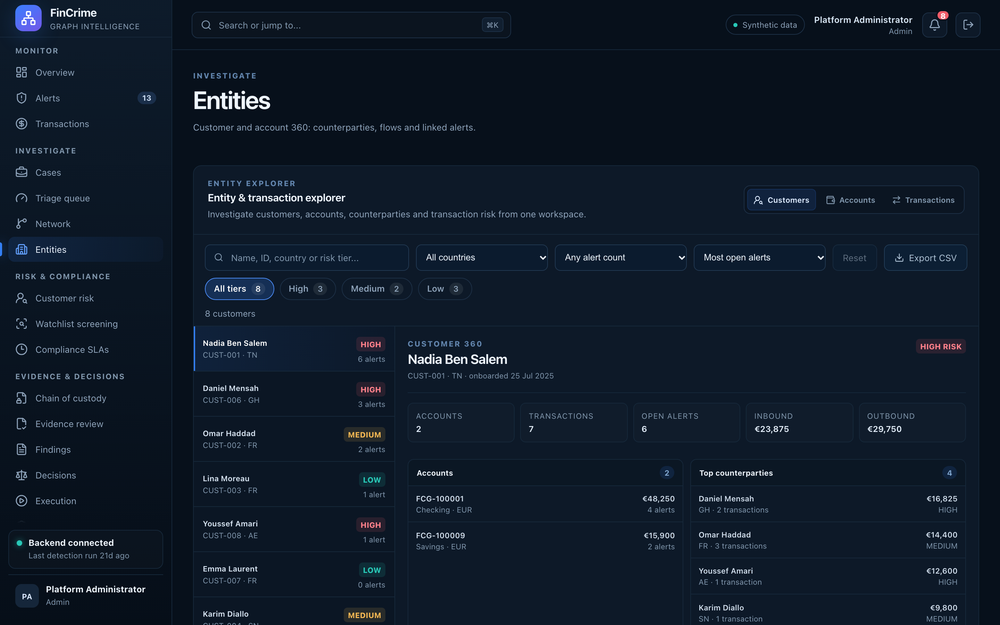

# Entities

**Caption:** Customer and account 360.

**Alt text:** Customer and account explorer

**Where in the app:** Sidebar: Entities (`#/entities`)

**Image:** 11-entities.png, 2,880 x 1,800 px, 523 KB, captured 2026-10-09

## Description

Customers and accounts with their counterparties, flows and linked alerts, so an analyst sees who they are dealing with without leaving the platform.

## Talking points

- Search that tolerates a failing API instead of throwing.
- Pre-filled from the command palette.
