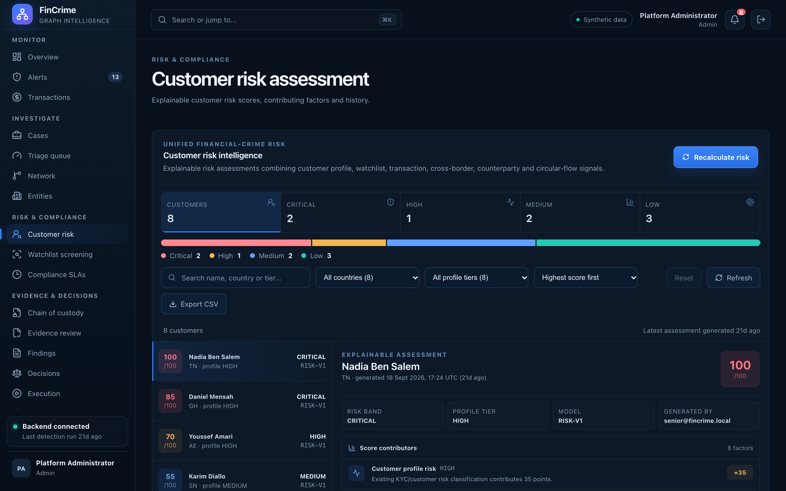

# Customer risk assessment

**Caption:** Explainable customer risk scores.

**Alt text:** Customer risk scores with contributing factors

**Where in the app:** Sidebar: Customer risk (`#/customer-risk`)

**Image:** 12-customer-risk.png, 2,880 x 1,800 px, 541 KB, captured 2026-10-09

## Description

Each customer's risk score is built from six factors: customer profile, watchlist matches, transaction volume, cross-border activity, high-risk counterparties and circular flow. The factors are shown, so the number can be defended.

## Talking points

- Explainability over a black-box score.
- Assessments are kept as history.
