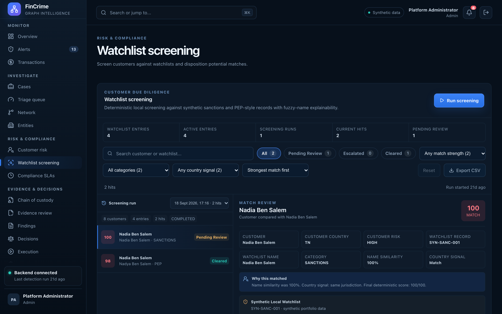

# Watchlist screening

**Caption:** Fuzzy name screening against watchlists.

**Alt text:** Watchlist screening results with potential matches

**Where in the app:** Sidebar: Watchlist screening (`#/watchlist`)

**Image:** 13-watchlist.png, 2,880 x 1,800 px, 557 KB, captured 2026-10-09

## Description

Customers are screened against watchlist entries with Levenshtein similarity, aliases included, and a match threshold of 80. Potential matches are cleared or escalated by an analyst with a note.

## Talking points

- Aliases are matched as well as primary names.
- A review decision is recorded with a note.
