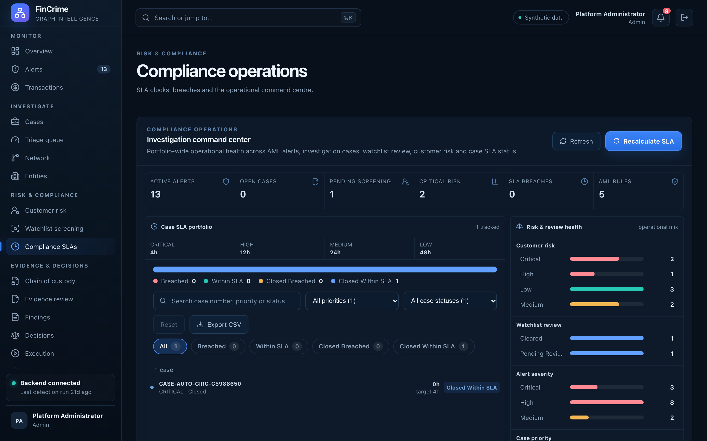

# Compliance operations

**Caption:** SLA clocks and the compliance command centre.

**Alt text:** Compliance command centre with SLA status

**Where in the app:** Sidebar: Compliance SLAs (`#/compliance`)

**Image:** 14-compliance.png, 2,880 x 1,800 px, 485 KB, captured 2026-10-09

## Description

Policy-driven SLA clocks for open cases, with breaches called out and a feed of recent activity, so a compliance lead sees where the process is slipping.

## Talking points

- SLA status is recalculated on demand and recorded.
- Senior analyst or administrator role required to recalculate.
