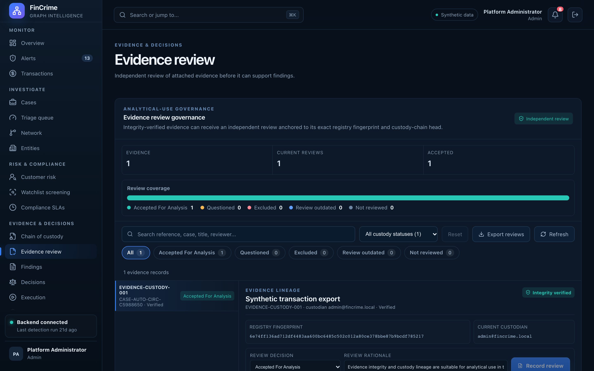

# Evidence review

**Caption:** Independent review before evidence counts.

**Alt text:** Evidence review queue

**Where in the app:** Sidebar: Evidence review (`#/evidence-review`)

**Image:** 16-evidence-review.png, 2,880 x 1,800 px, 522 KB, captured 2026-10-09

## Description

Attached evidence is reviewed before it can support a finding, and the reviewer must be someone other than the evidence's current custodian.

## Talking points

- Four-eyes rule enforced by the service, not by convention.
- Review decisions are part of the audit trail.
