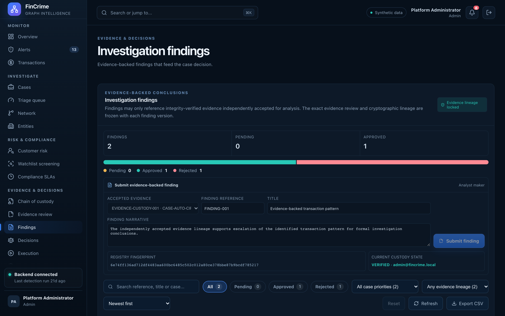

# Investigation findings

**Caption:** Findings that point back to their evidence.

**Alt text:** Investigation findings linked to evidence

**Where in the app:** Sidebar: Findings (`#/findings`)

**Image:** 17-findings.png, 2,880 x 1,800 px, 474 KB, captured 2026-10-09

## Description

Conclusions are recorded as findings, each tied to evidence that passed integrity verification and was accepted in review, so a decision can always be traced to what supports it. A finding is reviewed by someone other than its submitter.

## Talking points

- A finding can only rest on integrity-verified, accepted evidence.
- Feeds the decision step.
