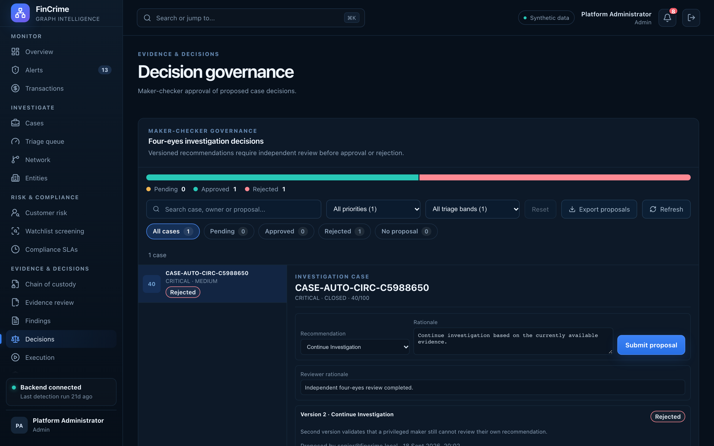

# Decision governance

**Caption:** Maker-checker approval of case decisions.

**Alt text:** Decision proposals awaiting approval

**Where in the app:** Sidebar: Decisions (`#/decisions`)

**Image:** 18-decisions.png, 2,880 x 1,800 px, 476 KB, captured 2026-10-09

## Description

Decisions are proposed by one person and reviewed by another. The service rejects a review by the proposer.

## Talking points

- Separation of duties enforced in a policy class with unit tests.
- Every transition is recorded.
