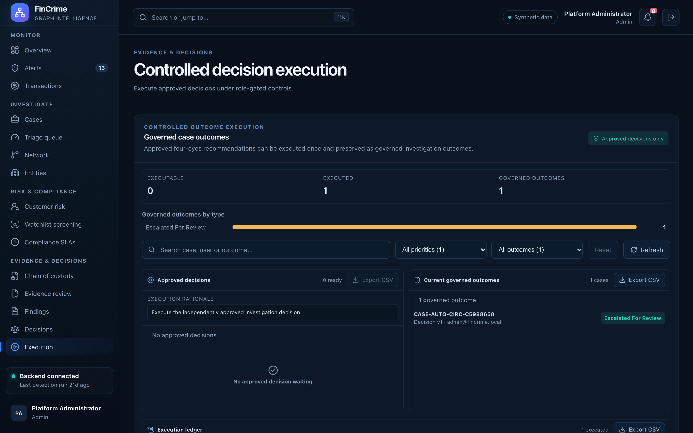

# Controlled decision execution

**Caption:** Approved decisions executed under role-gated controls.

**Alt text:** Decision execution ledger and outcomes

**Where in the app:** Sidebar: Execution (`#/execution`)

**Image:** 19-execution.png, 2,880 x 1,800 px, 442 KB, captured 2026-10-09

## Description

Only approved decisions can be executed, only by a senior analyst or administrator, and each execution and outcome is written to a ledger.

## Talking points

- Role-gated with Spring method-level security.
- Outcomes carry a provenance hash.
