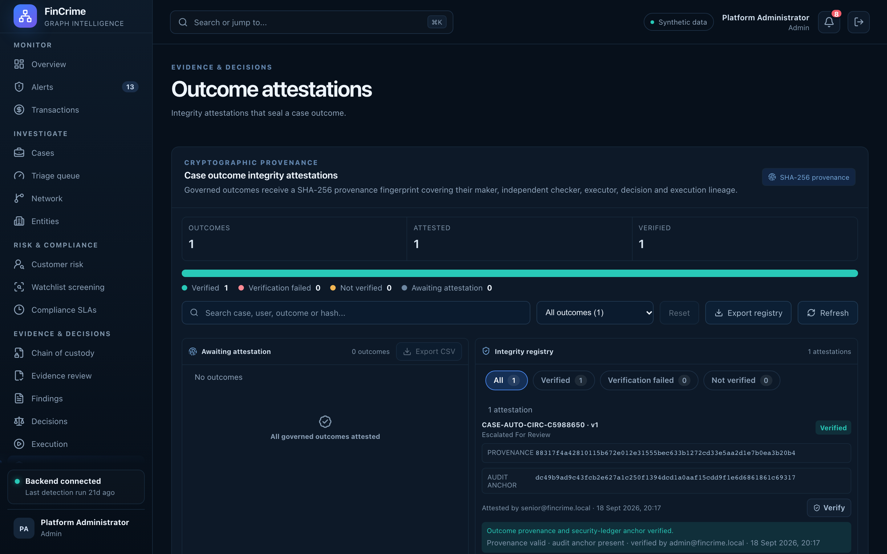

# Outcome attestations

**Caption:** Integrity attestations that seal a case outcome.

**Alt text:** Outcome attestations and verifications

**Where in the app:** Sidebar: Attestations (`#/attestations`)

**Image:** 20-attestations.png, 2,880 x 1,800 px, 470 KB, captured 2026-10-09

## Description

The outcome of a case is sealed with an attestation. Later verification shows whether the recorded outcome still matches what was attested.

## Talking points

- Seal and verify, with verification history.
- Built on SHA-256 hashing.
