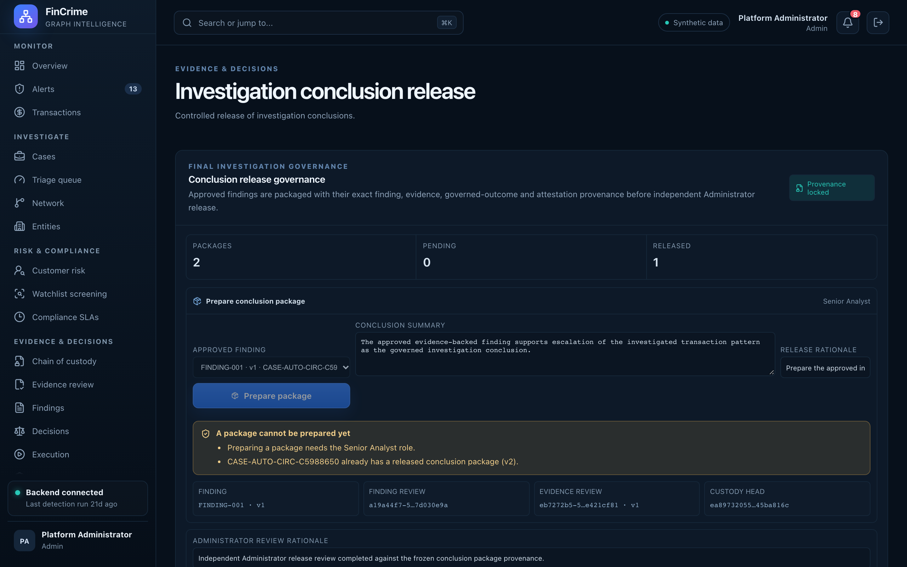

# Conclusion release

**Caption:** Controlled release of investigation conclusions.

**Alt text:** Conclusion release governance

**Where in the app:** Sidebar: Conclusion release (`#/release`)

**Image:** 21-release.png, 2,880 x 1,800 px, 446 KB, captured 2026-10-09

## Description

A conclusion leaves the investigation only through a controlled release. The reviewer must differ from whoever prepared the package, and a release fingerprint records exactly what was released.

## Talking points

- Release fingerprint (SHA-256) of the released content.
- Fourth four-eyes checkpoint, after evidence, findings and decisions.
