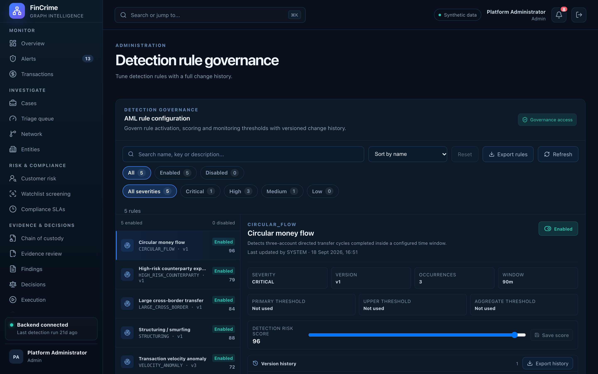

# Detection rule governance

**Caption:** Tune detection rules with a full change history.

**Alt text:** Detection rules with thresholds and change history

**Where in the app:** Sidebar: Detection rules (`#/rules`)

**Image:** 22-rules.png, 2,880 x 1,800 px, 524 KB, captured 2026-10-09

## Description

Detection thresholds are not hard-coded. A senior analyst or administrator can change a rule with a written change summary, and every change is kept in the history.

## Talking points

- Change summaries are sent in the request body, not the URL.
- Role-gated: an analyst cannot retune a rule.
