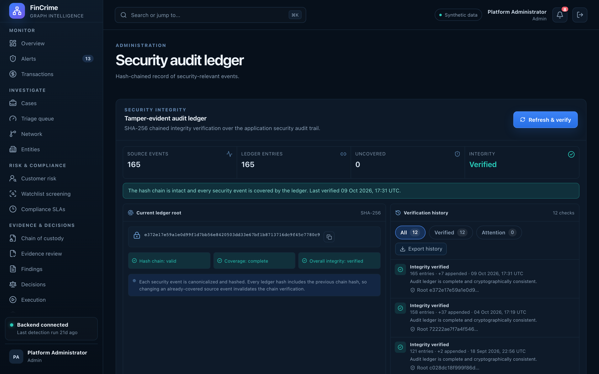

# Security audit ledger

**Caption:** A hash-chained record of security-relevant events.

**Alt text:** Security audit ledger with events and hash chain status

**Where in the app:** Sidebar: Audit ledger (`#/audit`)

**Image:** 23-audit.png, 2,880 x 1,800 px, 493 KB, captured 2026-10-09

## Description

Administrators can search security events by date range and check the ledger's hash chain. Each entry is chained to the one before, so removing or editing history is detectable.

## Talking points

- Server-side date-range search with a total count.
- Refresh extends the chain; verification reports whether it is valid.
