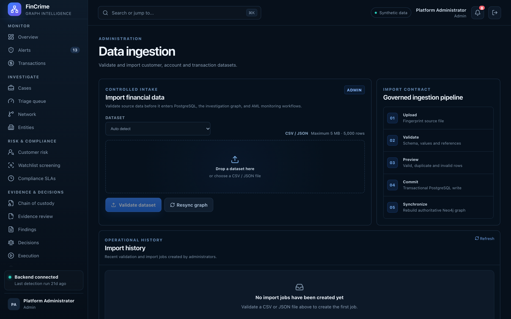

# Data ingestion

**Caption:** Validate and import customer, account and transaction data.

**Alt text:** Data ingestion centre with dataset validation and import jobs

**Where in the app:** Sidebar: Data ingestion (`#/ingestion`)

**Image:** 24-ingestion.png, 2,880 x 1,800 px, 527 KB, captured 2026-10-09

## Description

Upload CSV or JSON datasets, preview and validate them against a schema, import them and re-synchronise the graph. Each import is hashed and logged.

## Talking points

- Preview before import.
- Import jobs keep a log.
- The graph is re-synchronised from PostgreSQL afterwards.
