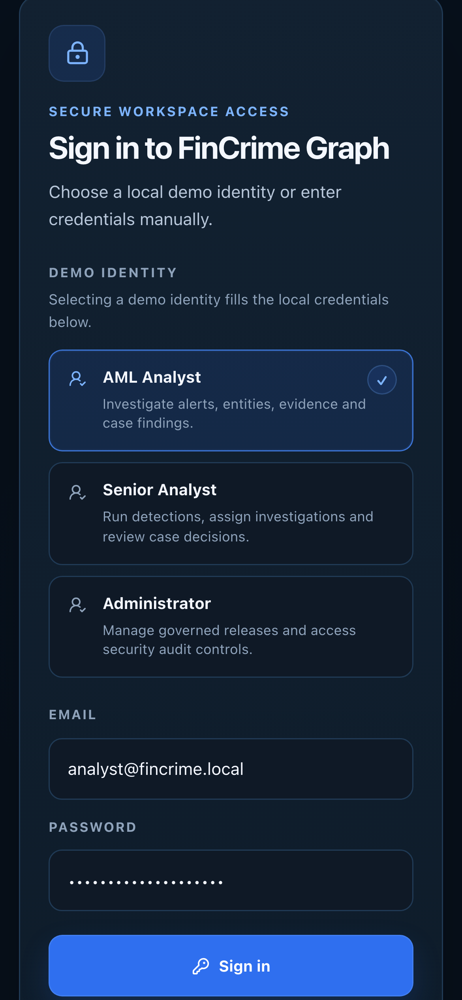

# Sign-in on a phone

**Caption:** The sign-in screen on a phone.

**Alt text:** Sign-in screen on a phone

**Where in the app:** Sign-in screen

**Image:** 26-mobile-login.png, 1,170 x 2,532 px, 296 KB, captured 2026-10-09

## Description

The same sign-in, laid out for a narrow screen.

## Talking points

- Same form, same demo identities, laid out for a narrow screen.
