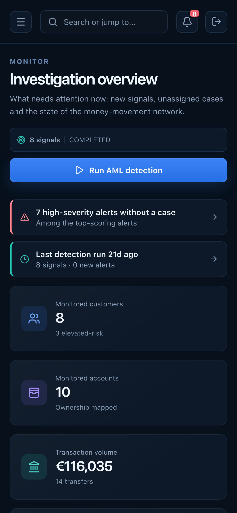

# Overview on a phone

**Caption:** The overview on a phone.

**Alt text:** Overview dashboard on a phone

**Where in the app:** Sidebar: Overview (`#/overview`)

**Image:** 27-mobile-overview.png, 1,170 x 2,532 px, 332 KB, captured 2026-10-09

## Description

Panels stack into a single column and the sidebar becomes an off-canvas menu.

## Talking points

- Breakpoints at 1180, 1024, 850, 780 and 480 px.
- Comfortable touch targets.
