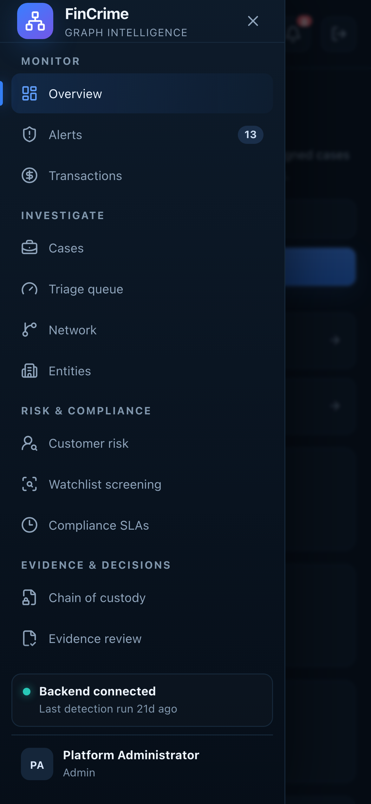

# Navigation menu on a phone

**Caption:** The grouped navigation as an off-canvas menu.

**Alt text:** Off-canvas navigation menu on a phone

**Where in the app:** Menu button in the top bar (phone width)

**Image:** 28-mobile-menu.png, 1,170 x 2,532 px, 362 KB, captured 2026-10-09

## Description

On screens up to 850 px the sidebar turns into a drawer with the same five groups, instead of an icon rail without labels.

## Talking points

- Focus is managed when the drawer opens and closes.
