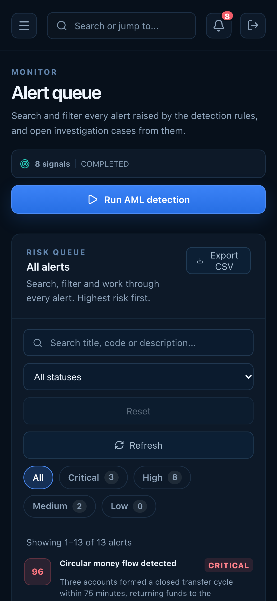

# Alerts on a phone

**Caption:** The alert queue on a phone.

**Alt text:** Alert queue on a phone

**Where in the app:** Sidebar: Alerts (`#/alerts`)

**Image:** 29-mobile-alerts.png, 1,170 x 2,532 px, 236 KB, captured 2026-10-09

## Description

Filters and the alert list reflow for one-handed use.

## Talking points

- Same server-side search and filters as on the desktop.
